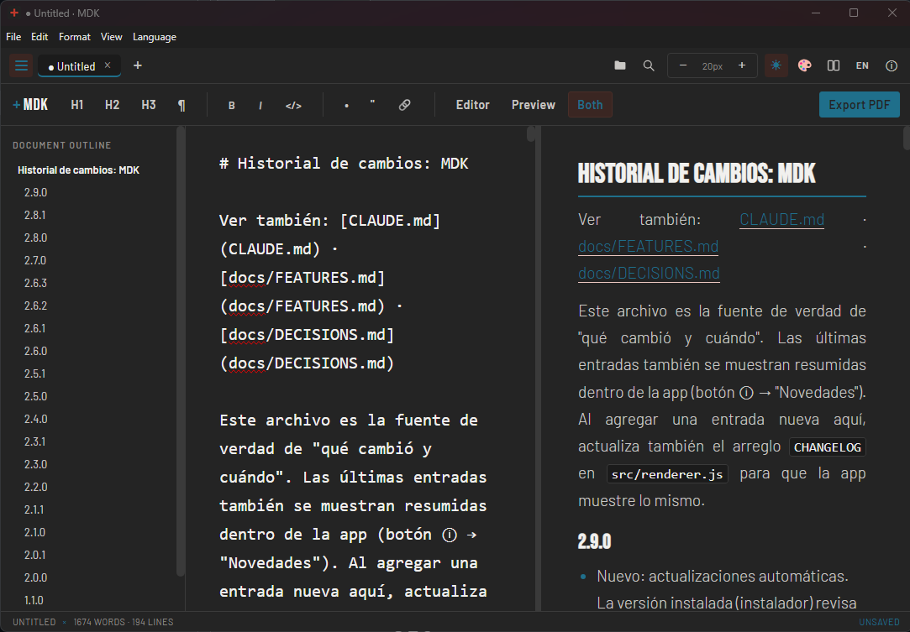
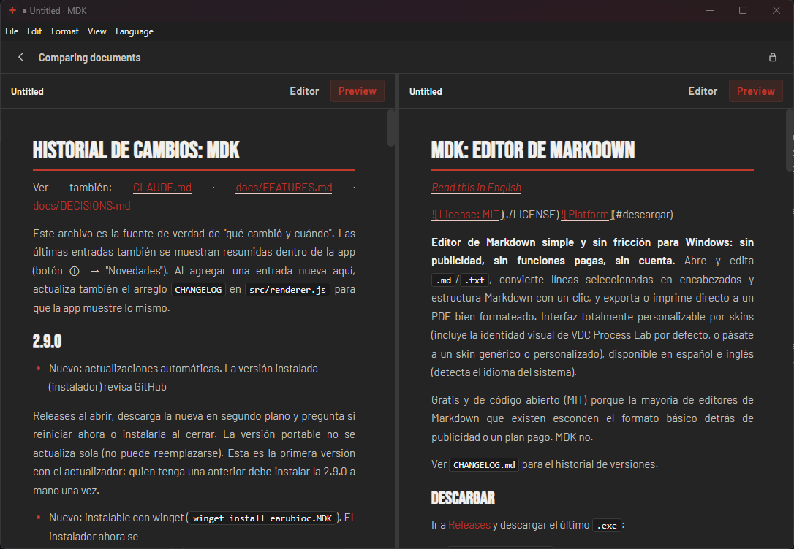
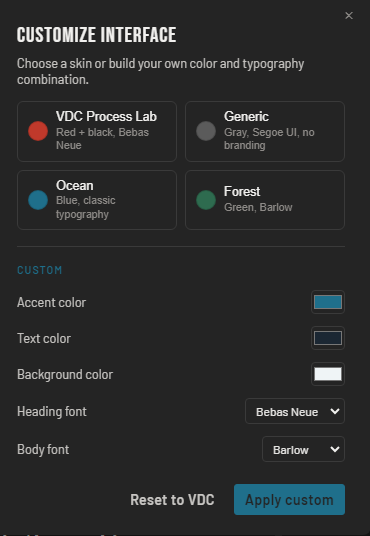

# MDK: Markdown editor

*[Leer en español](./README.es.md)*

[](./LICENSE)
[](#download)
[](../../releases/latest)

**A clean, no-nonsense Markdown editor for Windows: no ads, no paywalled features, no
account required.** Open and edit `.md`/`.txt`, turn selected lines into headings and
Markdown structure with one click, and export or print straight to a properly formatted
PDF. Fully skinnable interface (ships with the VDC Process Lab identity as the default,
or go fully generic/custom), available in Spanish and English.

Free and open source (MIT) because most Markdown editors out there bury basic formatting
behind ads or a paid tier. MDK doesn't.



<p>


</p>

Website: https://earubioc.github.io/mdk/

See [`CHANGELOG.md`](./CHANGELOG.md) for the version history.

## Download

Go to [Releases](../../releases) and download the latest `.exe`:

- **`MDK-Setup-X.X.X.exe`**: wizard-based installer (Desktop/Start Menu shortcuts).
  Recommended for most users; it updates itself automatically.
- **Microsoft Store**: [mdk Markdown Editor](https://apps.microsoft.com/detail/9PKLBD74P3J7) (signed by Microsoft, updated through the Store)
- **winget**: `winget install earubioc.MDK` (once the package is approved in the winget catalog)
- **`MDK-portable.exe`**: runs directly, nothing to install.

## Requirements

- Node.js 18+ and npm (only needed for development/packaging, not to run the compiled app)
- Windows 10/11, 64-bit

## Development

```bash
npm install
npm start
```

This opens the app in an Electron window over the code in `src/`.

## Android (MD Kraft)

The Android edition is published as **MD Kraft Markdown Editor** (`com.vdcprocesslab.mdkraft`; the name "MDK" is already taken on Google Play). It shows a banner ad (AdMob) and offers a one-time in-app purchase, **Remove ads** (US$ 1.99, product id `remove_ads`). The Windows app stays ad-free. A banner is always shown; a full-screen (possibly video) ad appears every 5 opened/created documents (min. 3 minutes apart, never while typing). Step-by-step publishing guide (AdMob, Play Console, testing): [`manual_android_para_dummies.md`](./manual_android_para_dummies.md) (Spanish).

`android/` wraps the same UI from `src/` in a native WebView (no Capacitor, no extra
dependencies; version comes from `package.json`). Open/save use the system file picker;
**Export PDF** and **Print** open Android's print dialog (choose "Save as PDF").

The APK is built by GitHub Actions (`.github/workflows/android.yml`): download
`MDKraft.apk` from the run's artifacts, or from the Release for a `vX.Y.Z` tag.
To build locally you need JDK 17 and the Android SDK (platform 34):

```bash
cd android && ./gradlew assembleRelease   # -> app/build/outputs/apk/release/
```

Ads use Google's **test** IDs until you set the `MDK_ADMOB_APP_ID` / `MDK_ADMOB_BANNER_ID` / `MDK_ADMOB_INTERSTITIAL_ID` secrets, and the `remove_ads` product must exist in Play Console (price US$ 1.99) before the purchase works. Without signing secrets the APK is signed with a debug key (fine for sideloading, but it
cannot update over a build made with another key). See the header of the workflow.

## Building the Windows executable

```bash
npm run dist              # builds portable + NSIS installer
npm run dist:portable     # portable .exe only (no install needed)
npm run dist:installer    # NSIS installer only (Desktop/Start Menu shortcut)
```

The artifacts land in `release/`. To install on another machine you only need to share
the final `.exe` (`MDK-Setup-X.X.X.exe` or `MDK-portable.exe`); everything else `release/`
leaves behind (`win-unpacked/`, `.yml`, `.blockmap`) is internal build support. See
[`manual_para_dummies.md`](./manual_para_dummies.md) for a no-jargon walkthrough (Spanish).
If `electron-builder` fails with a `winCodeSign` "symbolic link" error, enable Windows
"Developer Mode" (Settings → Privacy & Security → For developers) or run the terminal as
Administrator — this step signs the `.exe` and stamps MDK's own name/icon onto it, and
needs one of those two permissions on Windows.

Every push to `main` runs an automatic validation (GitHub Actions,
`.github/workflows/ci.yml`). Every `vX.Y.Z` tag builds the installer and the portable
executable and publishes them as a GitHub Release (`.github/workflows/release.yml`).

## Structure

```
MDK/
├── main.js               # Electron main process: window, menu, file dialogs, PDF export, language
├── preload.js             # secure bridge (contextBridge) between main and renderer
├── src/
│   ├── index.html          # tabbar, search bar, formatting toolbar, sidebar, panes, modals
│   ├── style.css           # app styles + skin variables
│   ├── renderer.js         # documents/tabs, formatting, skins, language, search, zoom, PDF
│   ├── markdown.js         # dependency-free Markdown → HTML converter
│   └── i18n/strings.js     # Spanish/English dictionary shared between main and renderer
├── .github/workflows/      # CI (validation) and Release (build + publish to GitHub)
├── package.json           # scripts and electron-builder configuration
├── LICENSE                 # MIT
├── CHANGELOG.md            # version history
└── manual_para_dummies.md  # no-jargon guide (build, install, associate .md), Spanish
```

## Usage

- **Language**: Spanish/English, auto-detects the system language on first launch; switch
  anytime from the ES/EN button or the "Language" menu, no restart needed
- **Tabs**: multiple documents open at once: new tab (Ctrl+N), close (Ctrl+W), reorder by dragging; closing a tab with changes asks Save / Don't save / Cancel
- **File**: Open (Ctrl+O), Save (Ctrl+S), Save as (Ctrl+Shift+S)
- **Formatting**: select one or more lines and press H1/H2/H3 in the toolbar (or
  Ctrl+1/2/3) to turn them into a heading (`#`, `##`, `###`); Ctrl+0 reverts to plain text.
  Bold (Ctrl+B), italic (Ctrl+I), inline code (Ctrl+E), list (Ctrl+L), quote (Ctrl+Shift+Q)
- **Editor / Preview / Split**: three view modes — Editor only (Ctrl+Shift+E), Preview
  only (Ctrl+Shift+V), or both side by side (Ctrl+Shift+B), with a draggable divider
- **Tables**: standard Markdown pipe tables (`| col | col |`) render in the preview and
  the exported PDF, including column alignment (`:---`, `---:`, `:---:`); in the preview
  you can also drag column borders to resize them for easier reading (visual only, it
  doesn't change the file)
- **Compare documents**: pick 2 open tabs and view them side by side (⧉ button or
  Ctrl+Shift+C), each side with its own Editor/Preview toggle, with an optional lock to
  scroll both panels together
- **Open a file**: double-click a `.md`/`.markdown` file (MDK registers the association on
  install), drag a file onto the window, or use File → Open recent for your last files
- **Document outline**: ☰ button shows/hides the heading structure (Ctrl+\); clicking an
  item jumps to that line
- **Search**: Ctrl+F, next/previous within the search bar
- **Zoom**: `− 16px +` buttons in the toolbar (Ctrl+= / Ctrl+-)
- **Dark mode**: ☾ button (Ctrl+Shift+D)
- **Skins**: 🎨 button: VDC Process Lab, Generic, Ocean, Forest, Reading (cream paper, serif), or a custom skin (your
  own colors and typography)
- **Document info**: ⓘ button: words, characters, lines, estimated tokens, and what's new
- **Export to PDF**: "Export PDF" button or Ctrl+P: saves a `.pdf` with the active skin
- **Print**: Ctrl+Shift+P opens the native Windows print dialog
- **Page setup**: "Page…" button: paper size (Letter, Oficio, Legal, A4, A5, A3), orientation and margins, used by PDF export and printing; the "Sheet" button previews the document as a sheet of that size
- **Math**: LaTeX formulas inline (`$E=mc^2$`) and as blocks (`$$ ... $$`), rendered as equations in the preview, comparison and PDF (built-in converter; covers fractions, roots, sums, integrals, matrices and more)

## License

MIT, see [`LICENSE`](./LICENSE). Free to use, copy, modify, and redistribute, including
commercially, with the sole condition of keeping the copyright notice.

**Exception:** the `android/` folder (MD Kraft for Android: ads and in-app purchase setup)
has its own license, [`android/LICENSE`](./android/LICENSE): you may read and build it for
personal use, but not publish or redistribute it, nor reuse its name, icon or ad/billing
configuration. The editor interface in `src/` stays MIT.
